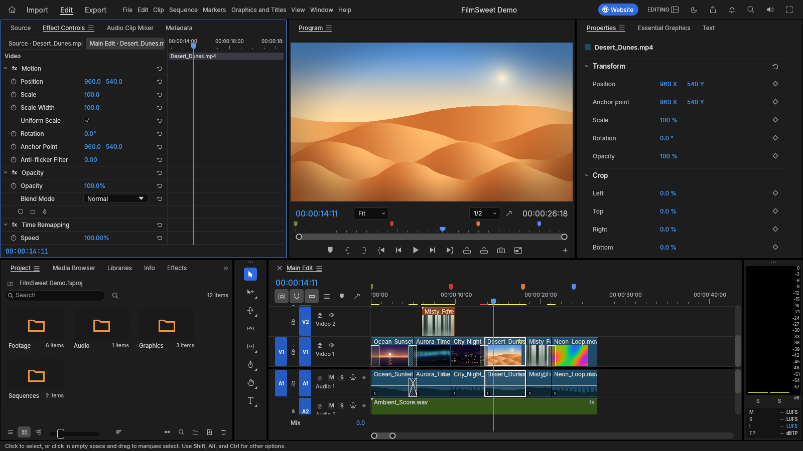
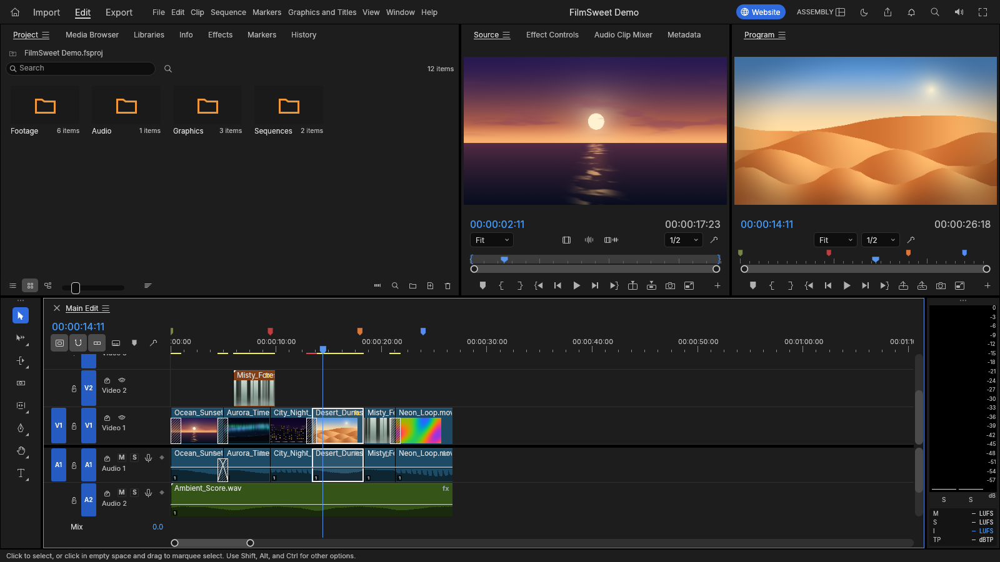
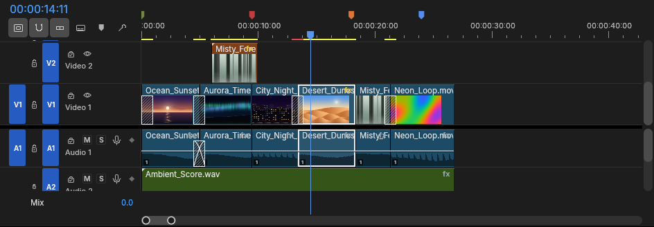
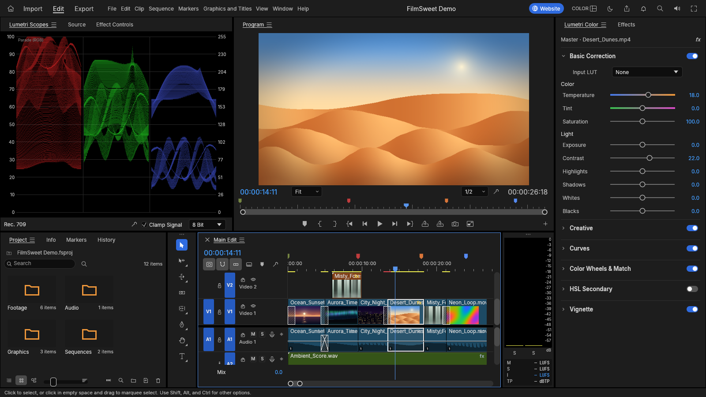
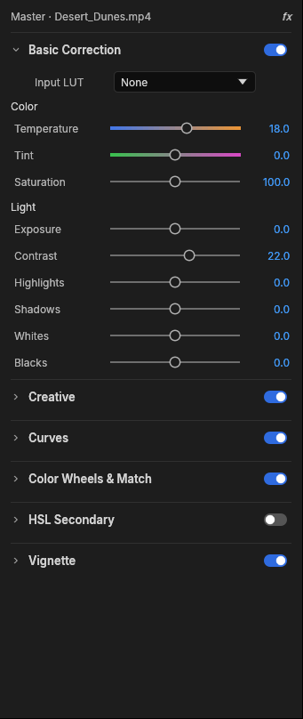
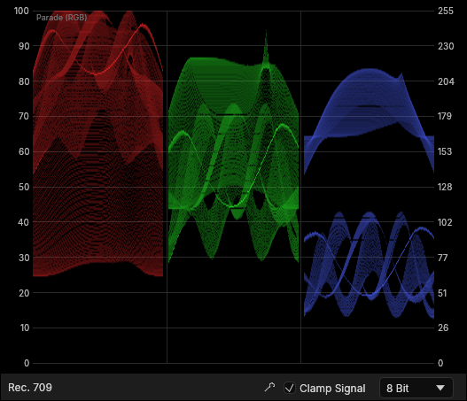
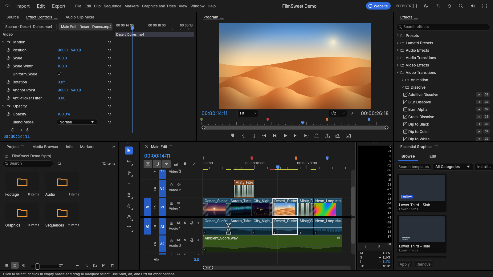
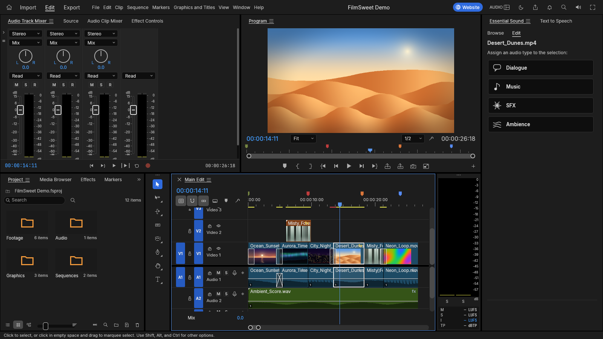
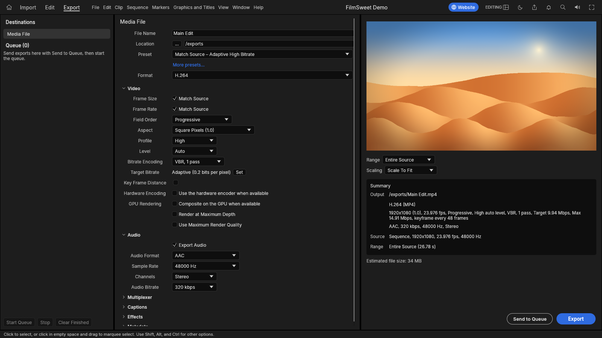

<p align="center">
  <a href="https://salim-studio.github.io/filmsweet/">
    
  </a>
</p>


<h1 align="center">FilmSweet</h1>

<p align="center">
  <b>Sharp underneath, sweet on top: an open-source, clean-room take on the Adobe Premiere Pro workflow, rebuilt from the bitstream up in pure Rust.</b>
</p>

<p align="center">
  Native on macOS, Windows and Linux, and in the browser as WebAssembly.<br>
  By salim-slimani.
</p>

<p align="center">
  <a href="#license-and-credits"></a>
  
  
  <a href="#status"></a>
</p>

<p align="center">
  <a href="https://salim-studio.github.io/filmsweet/"></a>
</p>

<br>

<p align="center">
  
</p>

<p align="center"><sub>The Editing workspace on FilmSweet's built-in demo project. Every frame in this screenshot &mdash; the dunes, the ocean sunset, the night drive &mdash; is generated by FilmSweet itself. There is no third-party footage anywhere in this project, and the same is true of the panel shots below.</sub></p>

## The mark

One glyph carries the whole idea. Look at the icon at the top of this page: a **film frame** &mdash; sprocket edges, the cell, the exact mechanical unit a movie is counted in &mdash; set on a **rose tile**, with a **play mark** cut cleanly out of the middle.

*Film* is the hard, rigid half: integer time, exact colour, a machine that does not drift. *Sweet* is the soft, human half: the colourist's intent, the editor's instinct, the click of a system that gets out of the way. FilmSweet is the two together, and the icon says so. Like every icon in the app, it is drawn in code, not traced or borrowed.

That tension runs through everything below. FilmSweet is a non-linear editor built for people who already know Premiere &mdash; the same panels, workspaces, tools and shortcuts, so your hands know where everything is &mdash; and it is a piece of software that takes nothing on faith from the ecosystem around it. Nothing here is a wrapper or a shim.

## What it is built on

- **Clean room.** No Adobe code, icons, LUTs, presets or sample projects; no GPL or LGPL code; no traced artwork. Every asset is openly licensed and attributed ([AGENTS.md](AGENTS.md), [ATTRIBUTION.md](ATTRIBUTION.md)).
- **One language, top to bottom.** The H.264, HEVC, ProRes, VP8, VP9, AV1, DNxHR, AAC and Opus codecs and the MP4, MOV, Matroska and AVI containers are our own Rust, written from the public ITU-T, ISO and IETF specifications. No FFmpeg inside.
- **Exact time.** Every edit is computed on integer ticks &mdash; 254,016,000,000 per second, which divides evenly by every common frame rate and sample rate. 23.976, 29.97 drop-frame and 59.94 are exact, never approximated.
- **Light that adds up.** A GPU compositor on wgpu (Metal, Vulkan, DirectX 12, WebGPU) samples YUV straight from the decoder, supersamples, and blends in linear light.
- **Everything is a command.** Every menu, button, slider and drag has an id and typed parameters, so the UI, the CLI, a JSON control channel and an MCP server all do the same work. A person and an agent are the same kind of user.
- **Yours.** Dual-licensed MIT or Apache-2.0, with no strings and no account.

<p align="center">
  <a href="#cut">Cut</a> ·
  <a href="#grade">Grade</a> ·
  <a href="#motion-and-effects">Motion</a> ·
  <a href="#sound">Sound</a> ·
  <a href="#type-and-captions">Type</a> ·
  <a href="#codecs-and-containers">Codecs</a> ·
  <a href="#delivery">Delivery</a> ·
  <a href="#hand-off">Hand-off</a> ·
  <a href="#built-for-machines">Machines</a> ·
  <a href="#get-started">Get started</a> ·
  <a href="#downloads">Downloads</a> ·
  <a href="#documentation">Docs</a> ·
  <a href="#status">Status</a>
</p>

> [!NOTE]
> **FilmSweet is a community of artists from all walks of life.** Digital, generative, music,
>   games &mdash; if you make things, you're one of us. **[Come say hi on the website](https://salim-studio.github.io/filmsweet/).**

<br>

## Cut

<p align="center">
  
</p>

<p align="center"><sub>The Assembly workspace, arranging the built-in demo project.</sub></p>

**A timeline you already know.** Source and Program monitors, bins with thumbnails, a multi-track timeline with patch and target buttons, sync locks and linked selection. Editing, Assembly, Color, Effects and Audio workspaces are all there, and every panel docks wherever you like.

- **Three-point editing.** Mark In and Out in the Source monitor, then insert (`,`) or overwrite (`.`) onto the patched tracks. Lift (`;`) and extract (`'`) take ranges back out.
- **Every trim.** Ripple, roll, slip, slide, rate stretch and razor. Trim mode selects edit points as ripple, roll or trim, nudges them a frame at a time (`⌥←` `⌥→`, ×5 with `⇧`), toggles the trim type with `⌃T` and extends to the playhead with `E`. `Q` and `W` ripple-trim to the playhead. The **Trim Monitor** shows both sides of the edit, and **dynamic trimming** trims live while it plays: `L` forward, `J` back, `K` to stop and commit as one undo step.
- **Exact to the tick.** Time is integer, so edits never drift, however long the session or heavy the mixed frame rates.
- **The details you reach for.** Markers with colours, names and durations; **Markers ▸ Export Markers as CSV…** for review notes; add edit (`⌘K`) on one or all tracks; nesting; copy, paste and paste insert; ripple delete and close gap; snapping; unlimited undo with a History panel.
- **Your keys.** A Keyboard Shortcuts editor (`⌥⌘K`) with a drawn keyboard, panel-specific shortcuts, conflict warnings and presets for the FilmSweet, Premiere Pro, Final Cut Pro and Avid layouts.
- **Never lose work.** Saves are atomic, auto-save keeps a rolling set of versions, and a crash-recovery journal written a second after each edit brings back unsaved changes after a crash or a power cut.

<p align="center">
  
</p>

<p align="center"><sub>Up close: dissolves on V1, an insert on V2, the generated score on A2, coloured markers on the ruler.</sub></p>

<br>

## Grade

<p align="center">
  
</p>

<p align="center"><sub>The Color workspace, with live scopes beside the Program monitor.</sub></p>

**A complete Lumetri-style grading panel**, ordered the way a colourist works:

- **Basic Correction:** temperature and tint, exposure, contrast, highlights, shadows, whites, blacks, saturation.
- **Creative:** eight built-in looks with an intensity control, plus faded film, sharpen and vibrance. The looks are colour transforms written in code, not LUT files.
- **Curves:** an RGB curve editor with monotone-cubic interpolation (no overshoot), plus hue vs saturation, hue vs hue, hue vs luma, luma vs saturation and saturation vs saturation.
- **Color Wheels:** shadow, midtone and highlight wheels, each with its own lightness control.
- **HSL Secondary:** key a colour by hue, saturation and luma, view the key as a matte, and correct only what you selected.
- **Vignette:** amount, midpoint, roundness and feather.

<table>
  <tr>
    <td width="34%" valign="top" align="center">
      <br>
      <sub><b>The Lumetri Color panel.</b> Every section carries its own on/off switch.</sub>
    </td>
    <td width="66%" valign="top" align="center">
      <br>
      <sub><b>Scopes that tell the truth.</b> The parade and waveform are computed from the graded frame, in 32-bit float, in linear light.</sub>
    </td>
  </tr>
</table>

<br>

## Motion and effects

<p align="center">
  
</p>

<p align="center"><sub>The Effects workspace, Effect Controls on the left and the Effects browser open on the dissolves.</sub></p>

- **Premiere 26's full Video Effects bin (93 effects in 16 folders), the Legacy bin and the obsolete effects old projects use, plus around 30 transitions.** Blurs (Bokeh, Focus, Compound), keys (Ultra Key, Track Matte), distortions (Corner Pin, Turbulent Displace, Warp Stabilizer), Lights & Glows, Immersive Video (VR) effects on equirectangular footage, Posterize Time, Echo and more. Cross dissolve, dip to black or white, film dissolve, wipes, irises, pushes, slides, zooms, page peel, cube spin and more.
- **Motion and opacity on every clip:** position, scale, rotation, anchor point and anti-flicker, plus 26 blend modes.
- **Keyframes like Premiere's:** linear, Bezier, auto and continuous Bezier, hold, ease in and ease out. Effect Controls shows a keyframe lane for every parameter under a time ruler with the playhead's handle, and each animated parameter opens into **value and velocity graphs** with draggable influence handles. Effect Controls and the Properties panel share the keyframe navigator (◀ ◆ ▶): add or remove the keyframe at the playhead, step to the previous or next one.
- **A GPU compositor** on wgpu (Metal, Vulkan, DirectX 12, WebGPU) that samples YUV straight from the decoder, supersamples by footprint and blends in linear light. A CPU path renders the same frames, and the two are tested against each other.

<br>

## Sound

<p align="center">
  
</p>

<p align="center"><sub>The Audio workspace: the Audio Track Mixer, and the demo sequence with its audio tracks below.</sub></p>

- **Loudness meters to broadcast standards.** Momentary, short-term and integrated loudness and true peak to ITU-R BS.1770 and EBU R128, alongside the peak meters. Our integrated reading matches ffmpeg's `ebur128` filter to the tenth of a LU.
- **Clip effects on our own DSP library:** parametric EQ, high-pass, low-pass and band-pass filters, dynamics, a true-peak limiter, delay, reverb, DeNoise, DeHummer, invert and pitch shift. Parameters can be keyframed. Effects stay continuous across scrubbing, playback and export, with latency compensated.
- **Audio Track Mixer and Audio Clip Mixer:** faders, pan, mute, solo, five insert slots per track (pre- or post-fader), sends, submixes and a Mix track, all sample-accurate and latency-compensated. 24 tracks with three effects each mix about six times faster than real time on one core.
- **Automation like a console:** Read, Latch, Touch and Write modes recorded live from the mixer during playback, shown and edited as track keyframes on the timeline. Plus the Audio Gain dialog (set, adjust, normalize) and constant-power crossfades.
- **Audio-clock playback.** The sound card is the master clock, so picture follows sound and never the other way round.

<br>

## Type and captions

- **A real text engine:** OpenType shaping with kerning and ligatures, bidirectional text, line breaking, tracking and leading, drawn in linear light and sharp at any scale or rotation.
- **Type, Shape and Pen tools** on the Program monitor: click to type, edit with a caret and selection, drag out rectangles, ellipses and paths. Graphic clips hold text and shape layers with fill, strokes, background and shadow, all keyframable, and edited in the Properties panel.
- **Captions:** caption tracks in Subtitle, CEA-608, CEA-708 and Teletext formats; import and export SRT, WebVTT and SCC with frame-exact timing; edit captions in the Text panel and burn them into exports.

<br>

## Codecs and containers

No FFmpeg inside. The video codecs, AAC, Opus and the containers are our own Rust, implemented from the public ITU-T, ISO and IETF specifications and tested frame by frame against ffmpeg as an external oracle.

| | Decode | Encode | Notes |
|---|:---:|:---:|---|
| **H.264 / AVC** | ✓ | ✓ | Decoder bit-exact on 37+ streams, 500–600 fps at 1080p. Encoder: High, Main and Baseline profiles, CABAC, B-frames, CRF/CBR/VBR/2-pass |
| **HEVC / H.265** | ✓ | | Main and Main 10, bit-exact on 41 streams (tiles, WPP, PCM, long-term references), about 225 fps at 1080p |
| **Apple ProRes** | ✓ | ✓ | Decodes 422 Proxy to 4444 XQ; export writes 422 HQ |
| **AAC-LC** | ✓ | ✓ | |
| **VP8** | ✓ | | Every coding tool, bitstream versions 0–3, hidden altref frames, alpha layer of transparent WebM; bit-exact with libvpx on its published VP8 test vectors; in WebM/Matroska and MP4 |
| **VP9** | ✓ | | Profiles 0–3, 8/10/12-bit, 4:2:0 to 4:4:4, tiles and superframes; bit-exact on 50+ streams; in WebM/Matroska and MP4 |
| **Opus** | ✓ | | SILK, CELT, hybrid and multistream surround; range-exact on every RFC 8251 conformance vector; in WebM/Matroska and MP4 |
| **AV1** | ✓ | | Main profile, 8/10-bit 4:2:0 and monochrome, every coding tool incl. film grain, superres and spatial layers; bit-exact with libdav1d on the libaom vectors tested; in MP4 and WebM/Matroska |
| **Avid DNxHD / DNxHR** | ✓ | ✓ | All SMPTE ST 2019-1 CIDs (LB to 444, 8/10/12-bit); export writes DNxHR in MOV |
| **MJPEG, PCM** | ✓ | ✓ | |
| **MP3, FLAC, ALAC, Vorbis** | ✓ | | Via the [symphonia](https://github.com/pdeljanov/Symphonia) crate (MPL-2.0) for now, to be replaced by our own |
| **MP4 / MOV** | ✓ | ✓ | Fragmented MP4, edit lists, timecode tracks |
| **Matroska / WebM** | ✓ | | Lacing, Cues, header stripping, HDR colour metadata |
| **AVI** | ✓ | | AVI 1.0 and OpenDML (files past 1 GB); Motion JPEG, H.264, HEVC and uncompressed RGB / YUV with PCM, MP3, MP2 or AC-3. DivX / Xvid and DV not yet |
| **Stills** | ✓ | ✓ | Import PNG, JPEG, GIF, WebP, TIFF and BMP (animated GIF and APNG as clips, with transparency); export PNG sequences and animated GIF |

Also imported: MPEG-2 / MPEG-1 video, AC-3, MP2, MXF (OP1a / OP-Atom), MPEG transport and program streams (AVCHD, broadcast, DVD), Ogg and image sequences. Not yet: AV1 export, camera RAW, E-AC-3. Hardware decoding works on macOS (VideoToolbox), Windows (Media Foundation) and, for H.264 and HEVC, Linux (VA-API); H.264 export can use NVIDIA's encoder on Windows and Linux (opt-in), and H.265 (HEVC Main, 8-bit) export works through it (NVENC on Windows, VideoToolbox on macOS) ([#30](https://github.com/salim-studio/filmsweet/issues/30)).

<br>

## Delivery

<p align="center">
  
</p>

<p align="center"><sub>Export mode, set to write the demo sequence as H.264 MP4.</sub></p>

- **H.264 MP4 with AAC, using our own encoders.** A 6-second 960×540 render takes 1.3 seconds and decodes in ffmpeg without a single warning, with strict error detection on.
- **Also:** Apple ProRes 422 HQ and Motion JPEG in QuickTime, MXF OP1a and Avid-style OP-Atom (DNxHR, ProRes or H.264 with PCM and start timecode), PNG sequences, animated GIF and WAV.
- **Background jobs** with progress and cancel, so you keep editing while it renders.
- **Render previews:** the render bar marks segments green, yellow or red; rendered previews are cached by content, so an edit only invalidates what it touches and undo brings the green back.

<br>

## Hand-off

Move timelines between FilmSweet and every other editor:

- **Final Cut Pro 7 XML (xmeml):** the format Premiere and DaVinci Resolve exchange. It carries nested sequences, transitions, generators, Motion, Opacity, Time Remap and audio levels, with keyframes.
- **FCPXML 1.9–1.11:** the spine, connected clips as lanes, transitions, retiming and compound clips.
- **OpenTimelineIO:** the open interchange format of the film industry, round-tripping every FilmSweet detail through `metadata.filmsweet`.
- **CMX 3600 EDL:** the oldest format still in use, with drop-frame timecode, dissolves, wipes, speed changes (`M2`) and one EDL per track.
- **AAF (Edit Protocol):** for Avid Media Composer and Pro Tools. Video and audio tracks, dissolves and dips, clip volume with keyframes, markers and source timecode; audio embedded or as separate WAV / AIFF files, trimmed with handles, with clip effects rendered in and broken out to mono, plus an optional video mixdown. Import reads AAF back, extracting embedded audio.
- **OMF 2.0:** the audio-post handoff: the audio tracks with crossfades and gain, sample-accurate, with the audio encapsulated or alongside.

Import merges the document's bins, media and sequences into your project as one undoable step, and links each media file it finds on disk.

<br>

## Built for machines

Every menu item, button, slider and drag in FilmSweet is a **command** with an id, typed parameters and an enabled state. There are more than 650 engine commands (`filmsweet-cli commands` lists them), with the rest of Premiere's catalogue on the way. The UI, the CLI, a JSON control channel and an **MCP server** all dispatch the same commands, so Claude or any agent can cut, trim, grade, mix and export exactly the way a person does. The UI can also be driven at the level of mouse and keyboard: every widget has an automation id, and agents can click, drag, type and take screenshots.

```jsonc
// over the control channel (JSON lines on TCP) or as MCP tool calls
{"method": "engine.execute", "params": {"command": "timeline.place",
  "params": {"item": 1, "track": "V1", "seconds": 0, "sourceIn": 284298240000000, "duration": 1270080000000}}}
{"method": "engine.execute", "params": {"command": "effects.setParam",
  "params": {"clip": 87, "effect": "lumetri", "param": "curve_luma", "value": [[0,0],[0.25,0.21],[0.75,0.82],[1,1]]}}}
{"method": "ui.screenshot", "params": {"path": "frame.png"}}
```

The demo project, its grade and the panel shots on this page were all produced through this same channel, by an agent driving the running app.

<br>

## Everywhere

- **Native** on macOS, Windows and Linux, with a native macOS menu bar.
- **The web:** the same engine and UI run in the browser via WebAssembly (`apps/filmsweet-web`, see [docs/web.md](docs/web.md)); every release ships it as `filmsweet-web-<version>.zip`. It is live at **[salim-studio.github.io/filmsweet](https://salim-studio.github.io/filmsweet/)**.
- **Swappable UI.** The interface is one crate (`ui-egui`) over the engine, so a different front end can replace it without touching editing logic.

<br>

## Get started

```sh
cargo run --release -p filmsweet                           # the desktop app, with a demo project
cargo run --release -p filmsweet -- --control 9876         # plus the JSON-lines control server
cargo run --release -p filmsweet-cli -- commands           # list every engine command
cargo run --release -p filmsweet-cli -- mcp                # MCP server (headless)
```

Japanese text in the interface and in titles comes from [craft-fonts](https://github.com/storytold/craft-fonts), an optional build input (release builds always include it; without it FilmSweet uses its own and the system's fonts):

```sh
git clone https://github.com/storytold/craft-fonts ../craft-fonts
CRAFT_FONTS_DIR="$PWD/../craft-fonts" cargo run --release -p filmsweet
```

The control protocol is documented in [docs/control-protocol.md](docs/control-protocol.md). Stuck, or want to show what you made? Ask on the [FilmSweet website](https://salim-studio.github.io/filmsweet/).

## Documentation

| | |
|---|---|
| [CONTRIBUTING.md](CONTRIBUTING.md) · [docs/contributing.md](docs/contributing.md) | Setup, quality gates, commit conventions, how to add commands, effects, codecs, panels and assets |
| [AGENTS.md](AGENTS.md) | The rules every contributor must follow: assets, clean room, licences |
| [docs/architecture.md](docs/architecture.md) | Layers, data model, time base, command system, render and export pipeline |
| [docs/testing.md](docs/testing.md) | Unit, property and ffmpeg-oracle tests, accuracy criteria, benchmarks |
| [docs/agents.md](docs/agents.md) | Driving FilmSweet over MCP and the control channel; how agents develop it |
| [docs/control-protocol.md](docs/control-protocol.md) | Control-channel and MCP reference |
| [docs/project-files.md](docs/project-files.md) | `.fsproj` format, schema migrations, auto-save and crash recovery |
| [docs/graphics.md](docs/graphics.md) · [docs/captions.md](docs/captions.md) | Text engine, graphic clips and tools; caption tracks and formats |
| [ROADMAP.md](ROADMAP.md) | Stage, parity numbers, languages, what's next and the progress log |
| [docs/target-app-parity.md](docs/target-app-parity.md) · [docs/gaps.md](docs/gaps.md) · [docs/roadmap.md](docs/roadmap.md) | Parity assessment against Premiere Pro, the ranked list of shortfalls, milestones and current focus |
| [docs/codec-parity.md](docs/codec-parity.md) · [docs/file-format-parity.md](docs/file-format-parity.md) · [docs/hardware-parity.md](docs/hardware-parity.md) · [docs/ui-parity.md](docs/ui-parity.md) · [docs/localization-parity.md](docs/localization-parity.md) | Parity checklists by dimension |

## Status

FilmSweet is young and moving fast. Editing, trimming, multicam, colour, keyframes, effects, titles, captions, mixing, codecs and export work today.

FilmSweet is in **alpha**. We track two numbers ([docs/target-app-parity.md](docs/target-app-parity.md), re-measured 2026-10-10 against Premiere Pro 26.5.2):

- **Feature breadth: ~86%.** Premiere Pro's menu items, effects, transitions, panels and formats that exist in FilmSweet (menus 92% and effects 100% measured).
- **Ready for real work: ~56%.** Our honest estimate of how close FilmSweet is to replacing Premiere on real projects.

The biggest gaps today:

- **Speed on big footage.** Hardware decoding works on macOS and Windows, and for H.264 and HEVC on Linux (VA-API, or NVDEC with NVIDIA's driver; VP9 and AV1 decode in software there). Blend modes and the most common effects run on the GPU, but Lumetri, keys and export rendering still run on the CPU; H.264 encoding can use the hardware encoder on macOS and on Windows and Linux with an NVIDIA GPU (opt-in, Export ▸ Hardware encoding), and H.265 export is hardware-only on both (HDR sequences export Main 10 PQ / HLG with NVENC; VideoToolbox writes 8-bit SDR) ([#30](https://github.com/salim-studio/filmsweet/issues/30)).
- **Premiere projects.** `.prproj` files can't be opened yet; bring sequences over as FCP7 XML, AAF or OTIO.
- **No plugins.** No VST3 / Audio Units or OpenFX hosting.
- **Delivery codecs.** H.264 is our only software delivery-codec export; H.265 exports only through a hardware encoder (NVIDIA on Windows: Main 8-bit SDR and Main 10 HDR PQ / HLG; VideoToolbox on macOS: 8-bit Main, SDR); no AV1 export yet.
- **Real-world media and platforms.** Our decoders are bit-exact on conformance streams, but camera and phone files in the wild are less tested. Windows and Linux get far less testing than macOS.
- **AI features.** Few so far; speech to text is optional and off by default.

Bug reports with real footage are the most useful thing you can send us: [open an issue](https://github.com/salim-studio/filmsweet/issues) or tell us on the [FilmSweet website](https://salim-studio.github.io/filmsweet/).

## Architecture

A layered Cargo workspace:

| Layer | Crates |
|---|---|
| Codecs and containers | `h264`, `h264enc`, `hevc`, `vp9`, `prores`, `aac`, `opus`, `isobmff`, `matroska`, `avi`, `bitstream` |
| Foundations | `time`, `geom`, `color`, `frame`, `media`, `text`, `project`, `audio-dsp` |
| Editing and interchange | `edit`, `codecs`, `captions`, `format` (project files), `interchange` |
| Rendering and output | `render`, `gpu`, `export` |
| Engine | `engine`: command registry, session, undo, jobs |
| Front ends | `ui-egui`, `automation` (MCP), `apps/filmsweet`, `apps/filmsweet-cli` |
| Test support | `testkit` (ffmpeg oracles, fixtures), `golden` (golden-image tests) |

Nothing below the front ends depends on a UI toolkit or OS API. `cargo xtask ci` checks formatting, lints, tests, the layering rules, asset attribution and the wasm build.

## Downloads

**New to FilmSweet?** Download it from the [FilmSweet page on salim-studio.github.io/filmsweet](https://salim-studio.github.io/filmsweet). That's the easiest way to install it.

**Want a specific build or format?** On GitHub, the [latest release](https://github.com/salim-studio/filmsweet/releases/latest) has every build listed below, and [all releases](https://github.com/salim-studio/filmsweet/releases) has earlier versions and their notes. `<ver>` in the file names is the version number, and `SHA256SUMS.txt` lists a checksum for every file.

### Windows

| Build | Installer | Portable |
|---|---|---|
| x64 (64-bit Intel/AMD) | `filmsweet-<ver>-windows-x64.msi` | `filmsweet-<ver>-windows-x64-portable.zip` |
| arm64 (Snapdragon and other ARM PCs) | `filmsweet-<ver>-windows-arm64.msi` | `filmsweet-<ver>-windows-arm64-portable.zip` |
| x86 (32-bit) | `filmsweet-<ver>-windows-x86.msi` | `filmsweet-<ver>-windows-x86-portable.zip` |

Installers and executables are code-signed.

**If the app doesn't open on Windows:** the desktop app initializes only Vulkan and DirectX 12 by
default, not OpenGL. Letting wgpu also create an OpenGL instance can crash some graphics drivers (AMD's
`atio6axx.dll`) before the window appears, so the app would flash in Task Manager and quit.
`WGPU_BACKEND` overrides the default for troubleshooting (for example `dx12` or `vulkan`). In
PowerShell, from the folder containing the executable:

```powershell
$env:WGPU_BACKEND = "vulkan"
& .\filmsweet.exe
Remove-Item Env:WGPU_BACKEND                     # restore the default for later launches
```

An explicit `gl` override can bring the driver crash back on affected systems. The macOS, Linux
and web backend defaults are unchanged.

A PC whose GPUs were installed from different driver packages of one vendor (a laptop with an
integrated and a discrete AMD GPU, for example) can list one GPU twice, once through each installed
version of the Vulkan driver, and a window drawn through the stale one crashes inside the driver
(`amdvlk64.dll`, exit code `0xc0000005`). FilmSweet draws with the newer one and says so in
`%APPDATA%\FilmSweet\Logs\filmsweet.log`; installing one driver package for every GPU removes the
duplicate. With one driver per GPU the adapter is the one wgpu picks, as before.

### macOS

| Build | File | Notes |
|---|---|---|
| App, universal (Apple silicon + Intel) | `filmsweet-<ver>-macos-universal.dmg` | Signed and notarized |
| Command-line tool, universal | `filmsweet-cli-<ver>-macos-universal.zip` | Signed and notarized |

### Linux

| Format | x86_64 | aarch64 (ARM64) | Notes |
|---|---|---|---|
| AppImage | `filmsweet-<ver>-linux-x86_64.AppImage` | `filmsweet-<ver>-linux-aarch64.AppImage` | Runs anywhere; updates itself with [AppImageUpdate](https://github.com/AppImageCommunity/AppImageUpdate) (`.zsync` files) |
| Flatpak | `filmsweet-<ver>-linux-x86_64.flatpak` | `filmsweet-<ver>-linux-aarch64.flatpak` | Sandboxed; `flatpak install --user <file>` |
| Debian/Ubuntu | `filmsweet-<ver>-linux-x86_64.deb` | `filmsweet-<ver>-linux-aarch64.deb` | |
| Fedora/RHEL/openSUSE | `filmsweet-<ver>-linux-x86_64.rpm` | `filmsweet-<ver>-linux-aarch64.rpm` | |
| Tarball | `filmsweet-<ver>-linux-x86_64.tar.gz` | `filmsweet-<ver>-linux-aarch64.tar.gz` | Unpack and run `./install.sh` |

RISC-V (riscv64): `filmsweet-<ver>-linux-riscv64.tar.gz` (tarball only; needs glibc 2.39+, e.g. Ubuntu 24.04
or Debian 13).

The tarball installer places FilmSweet, its command-line tool and desktop integration in
`~/.local`, without administrator permissions. For all users, run
`sudo ./install.sh --prefix /usr/local` instead. Running the installer again updates the installation.

**Gentoo (community-maintained):** the [::snakebyte overlay](https://github.com/switch87/snakebyte-overlay)
packages the Linux release as `media-video/filmsweet-bin`. It is maintained by the community, not by the
FilmSweet team, so report packaging problems to the overlay:

```sh
eselect repository add snakebyte git https://github.com/switch87/snakebyte-overlay.git
emaint sync -r snakebyte
echo 'media-video/filmsweet-bin ~amd64' >> /etc/portage/package.accept_keywords/filmsweet
emerge --ask media-video/filmsweet-bin
```

### FreeBSD

| Build | File |
|---|---|
| x86_64 | `filmsweet-<ver>-freebsd-x86_64.tar.gz` |

### Web (WebAssembly)

| Build | File | Notes |
|---|---|---|
| Static site | `filmsweet-web-<ver>.zip` | Runs in a modern browser; host it on any static server |

## Community

FilmSweet is free, open-source software, built from scratch in Rust and able to stand on its own.
Come make things with us: share what you're working on, ask for help, or tell us what's broken.

<p align="center">
  <a href="https://salim-studio.github.io/filmsweet/"><b>Website</b></a> ·
  <a href="https://github.com/salim-studio/filmsweet">GitHub</a> ·
  <a href="https://github.com/salim-studio/filmsweet/issues">Issues</a>
</p>

<br>

## License and credits

FilmSweet is dual-licensed under [MIT](LICENSE-MIT) or [Apache-2.0](LICENSE-APACHE), at your option.
Copyright (c) 2026 salim-slimani and the FilmSweet contributors. Required notices are in [NOTICE](NOTICE).

Bundled fonts, icons, images and other assets keep their own open licenses; each one is listed
with its author, source and license in [ATTRIBUTION.md](ATTRIBUTION.md). Builds made with
[craft-fonts](https://github.com/storytold/craft-fonts) (all official releases) also embed its fonts
(OFL-1.1), listed in its [ATTRIBUTION.md](https://github.com/storytold/craft-fonts/blob/main/ATTRIBUTION.md).

**Footage in the screenshots:** the project is FilmSweet's built-in demo. Every clip, still and
generated sound in the shots above is created by FilmSweet's own code at run time
(`crates/media/src/generators.rs`), so there is no third-party, stock or public-domain media to
credit and none is shipped. The icon, the UI glyphs and the demo media are all original work under
the project licence.

FilmSweet is an independent implementation. It contains no Adobe code, icons, images, presets or LUTs, and no GPL or LGPL code; every icon and every brand mark is drawn in code and every asset is openly licensed and attributed ([AGENTS.md](AGENTS.md)). ffmpeg is used only as an external test oracle.

<sub>Adobe, Photoshop, Illustrator, Premiere Pro, Lightroom, Acrobat, After Effects and InDesign are trademarks or registered trademarks of Adobe Inc. in the United States and/or other countries. FilmSweet is an independent, open-source project and is not affiliated with, sponsored by or endorsed by Adobe Inc.; these names are used only to describe the workflows it is compatible with.</sub>

<br>

<p align="center">
  <a href="https://salim-studio.github.io/filmsweet/"></a><br>
  <sub>Made by <a href="https://github.com/salim-studio">salim-slimani</a> and the FilmSweet contributors.</sub>
</p>

## Star history

[](https://www.star-history.com/?repos=salim-studio%2Ffilmsweet&type=date&legend=top-left)
